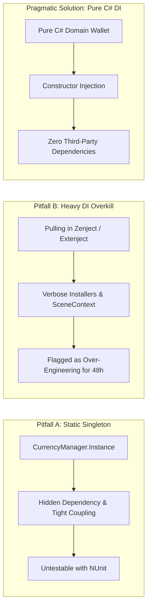
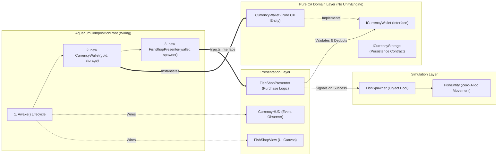

# Unity Aquarium Simulator Demo

[-blue.svg)](https://unity.com/)
[](LICENSE)
[]()
[]()

> A reference implementation demonstrating **Just-Enough Architecture** for timed game development assessments (such as a 48-hour take-home test). It solves the common dilemma: **how to avoid global Singletons without introducing heavy DI framework over-engineering (Zenject/Extenject)**.

---

## 📖 Context & The 48-Hour Dilemma

In game developer recruitment tests, candidates are frequently tasked with building a feature-complete prototype under tight deadlines (e.g. 48 hours):
1. **Economic Core:** Allow players to purchase new fish entities using local currency (`Gold`).
2. **Simulation Core:** Maintain a flock of active swimming fish running smoothly at 60 FPS without frame drops or memory leaks.

### The Two Common Pitfalls:



- **Pitfall A (Global Singleton):** Easy to write (`CurrencyManager.Instance.TrySpend()`), but tightly couples UI to game systems, conceals dependencies, and makes writing automated unit tests impossible without entering Play Mode. Reviewers frequently reject this pattern.
- **Pitfall B (Heavy DI Container):** Installing large DI frameworks (Zenject/Extenject) into a 2-day prototype adds setup overhead, reflection costs, and often gets flagged as a violation of **YAGNI** (You Aren't Gonna Need It).
- **The Pragmatic Solution:** **Pure C# Dependency Injection** paired with a single `AquariumCompositionRoot` component. It adds only ~20 lines of code, requires **zero external packages**, and makes business logic **100% unit-testable**.

---

## 🏗️ Architecture & Decoupling



### Key Architectural Highlights:
1. **Domain Isolation (`Aquarium.Domain`):** Contains pure C# business rules (`CurrencyWallet`, `ICurrencyWallet`, `ICurrencyStorage`). Its assembly definition has `"noEngineReferences": true`, guaranteeing zero coupling to `UnityEngine.dll`.
2. **Pluggable Persistence (`Aquarium.Infrastructure`):** `PlayerPrefsCurrencyStorage` implements `ICurrencyStorage`. If the project migrates to JSON or cloud saves, the domain wallet remains untouched.
3. **Event Lifecycle Hygiene (`CurrencyHUD`):** UI components observe `OnBalanceChanged` with clean `OnEnable` (`+=`) and `OnDisable` (`-=`) handling, preventing delegate memory leaks and zombie objects.
4. **Thread-Safe Simulation Boundaries:** The simulation layer can leverage C# Job System / Burst without risking data races on `CurrencyWallet`, as economy updates are safely marshaled to the Main Thread.

---

## 📂 Project Structure & Assembly Boundaries

```
Assets/
├── Scripts/
│   ├── Domain/                 # Pure C# (noEngineReferences: true)
│   │   ├── ICurrencyWallet.cs
│   │   ├── CurrencyWallet.cs
│   │   ├── ICurrencyStorage.cs
│   │   ├── FishSpeciesConfig.cs
│   │   └── Aquarium.Domain.asmdef
│   ├── Infrastructure/         # Storage implementations (PlayerPrefs)
│   │   ├── PlayerPrefsCurrencyStorage.cs
│   │   └── Aquarium.Infrastructure.asmdef
│   ├── Presentation/           # Presenters & UI Views (UGUI)
│   │   ├── FishShopPresenter.cs
│   │   ├── FishShopView.cs
│   │   ├── CurrencyHUD.cs
│   │   └── Aquarium.Presentation.asmdef
│   ├── Simulation/             # Fish movement & Object Pooling
│   │   ├── FishEntity.cs
│   │   ├── FishSpawner.cs
│   │   └── Aquarium.Simulation.asmdef
│   └── Composition/            # Single Scene Wiring Point
│       ├── AquariumCompositionRoot.cs
│       └── Aquarium.Composition.asmdef
└── Tests/
    └── EditMode/               # NUnit Automated Test Suite
        ├── CurrencyWalletTests.cs
        ├── FishShopPresenterTests.cs
        └── Aquarium.Tests.asmdef
```

---

## 🧪 Automated Unit Testing

All business rules are tested using **NUnit** in Unity's Test Runner (`EditMode`). Tests execute in milliseconds without launching the scene or waiting for Play Mode initialization:

### Test Suites Included:
- **`CurrencyWalletTests`:**
  - `Constructor_NegativeInitialBalance_ClampsToZero`
  - `Constructor_WithStorage_LoadsExistingBalance`
  - `Add_PositiveAmount_IncreasesBalanceAndFiresEvent`
  - `Add_NegativeOrZeroAmount_DoesNotChangeBalanceOrFireEvent`
  - `TrySpend_SufficientBalance_DeductsAmountAndReturnsTrue`
  - `TrySpend_InsufficientBalance_FailsAndKeepsBalanceIntact`
  - `TrySpend_ZeroOrNegativeAmount_ReturnsFalse`
- **`FishShopPresenterTests`:**
  - `Constructor_NullWallet_ThrowsArgumentNullException`
  - `TryPurchaseFish_WhenWalletAllows_InvokesSpawnCallbackAndReturnsTrue`
  - `TryPurchaseFish_WhenWalletRejects_DoesNotSpawnAndReturnsFalse`
  - `TryPurchaseFish_InvalidInput_ReturnsFalseWithoutCallingWallet`

To run tests in Unity:
1. Open the project in **Unity 6 (6000.0.75f1)** or **Unity 2022 LTS**.
2. Go to **Window > General > Test Runner**.
3. Select **EditMode** and click **Run All**.

---

## 📚 Deep-Dive Technical Articles

For a full technical breakdown of the engine mechanics, reviewer grading rubrics, and trade-off comparisons:
- 🇻🇳 [Bài test kỹ thuật 48 giờ: Tránh bẫy Singleton mà không cần over-engineering bằng DI framework (toanlb.dev)](https://toanlb.dev/posts/bai-test-48h-singleton-hay-di-framework/)
- 🇺🇸 [The 48-Hour Technical Take-Home Test: Avoiding the Singleton Trap Without Over-Engineering (toanlb.dev/en)](https://toanlb.dev/en/posts/take-home-test-singleton-vs-di-framework/)

---

## 📄 License

This repository is distributed under the **MIT License**. See [LICENSE](LICENSE) for details.
